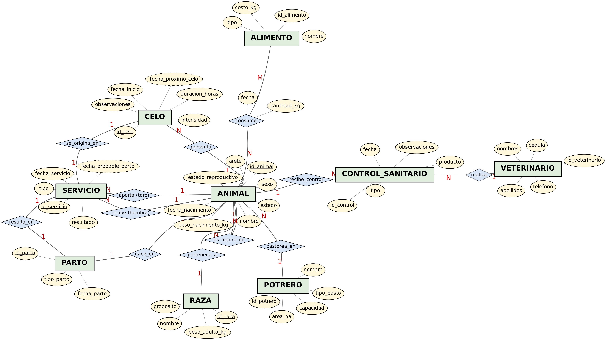
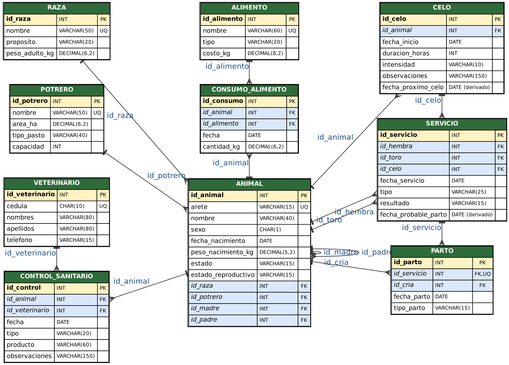

# Sistema de Gestión Ganadera (bovinos) — Base de datos relacional

Proyecto de fin de la **Unidad 1** de la asignatura **Base de datos** (Ciclo 3 A, Universidad Nacional de Loja — FEIRNNR, Carrera de Computación).

Base de datos en **MySQL** para administrar el ganado bovino de una hacienda: registro de animales (fecha de nacimiento, raza, potrero, genealogía), consumo de alimento, **ciclo de celo**, servicios reproductivos, partos y control sanitario.

**Autor:** [@fabriciomacas](https://github.com/fabriciomacas)

## Problema que resuelve

En muchas haciendas el hato se registra en cuadernos o de memoria. Eso dificulta conocer la genealogía de cada animal, cuánto y qué come cada vaca (y cuánto cuesta), cuándo fue su último celo y cuándo puede parir. El sistema centraliza esos datos con integridad referencial y permite consultarlos con SQL.

## Contenido del repositorio

```
.
├── docs/
│   ├── Informe_Evaluacion_U1.docx   # Informe completo (contexto, objetivos, E-R, relacional, SQL, consultas, conclusiones, bibliografía IEEE)
│   └── diagramas/
│       ├── er.png                   # Diagrama Entidad-Relación (notación de Chen)
│       ├── rel.png                  # Diagrama relacional
│       └── *.dot, *.py              # Fuentes (Graphviz) para regenerar los diagramas
└── sql/
    ├── 01_esquema.sql               # DDL: crea la base `ganaderia` y las 10 tablas
    ├── 02_datos.sql                 # DML: datos de ejemplo coherentes
    ├── 03_consultas.sql             # 5 consultas (álgebra relacional → SQL)
    └── ganaderia_completo.sql       # Los tres anteriores en un solo script
```

## Modelo de datos

**10 tablas:** `RAZA`, `POTRERO`, `VETERINARIO`, `ALIMENTO`, `ANIMAL`, `CONSUMO_ALIMENTO`, `CELO`, `SERVICIO`, `PARTO`, `CONTROL_SANITARIO`.

| Relación | Cardinalidad | Implementación |
|---|---|---|
| ANIMAL – RAZA / POTRERO | N:1 | `id_raza`, `id_potrero` en `ANIMAL` |
| ANIMAL – ANIMAL (madre / padre) | 1:N recursiva | `id_madre`, `id_padre` en `ANIMAL` |
| ANIMAL – ALIMENTO | M:N | tabla `CONSUMO_ALIMENTO` (fecha, cantidad_kg) |
| ANIMAL – CELO | 1:N | `CELO.id_animal` |
| ANIMAL – SERVICIO (hembra / toro) | 1:N y 1:N | `id_hembra`, `id_toro` en `SERVICIO` |
| CELO – SERVICIO – PARTO – cría | 1:1 | `SERVICIO.id_celo`, `PARTO.id_servicio` (UNIQUE), `PARTO.id_cria` |
| ANIMAL / VETERINARIO – CONTROL_SANITARIO | 1:N | `id_animal`, `id_veterinario` |

**Columnas calculadas automáticamente** (`GENERATED ... STORED`):
- `CELO.fecha_proximo_celo` = `fecha_inicio` + 21 días
- `SERVICIO.fecha_probable_parto` = `fecha_servicio` + 283 días





## Cómo ejecutarlo

Requiere MySQL 8.0 (o MariaDB 10.3+). Los scripts se probaron en MariaDB 10.11.

```bash
# Todo en uno (recrea la base `ganaderia`)
mysql -u root -p < sql/ganaderia_completo.sql

# O por pasos
mysql -u root -p < sql/01_esquema.sql
mysql -u root -p < sql/02_datos.sql
mysql -u root -p < sql/03_consultas.sql
```

> `01_esquema.sql` ejecuta `DROP DATABASE IF EXISTS ganaderia`: borra la base si ya existía.

## Consultas (álgebra relacional → SQL)

| # | Operador | Pregunta que responde |
|---|---|---|
| 1 | σ + π | Celos prolongados (≥ 18 h) desde julio de 2026 y fecha del siguiente celo |
| 2 | ⋈ (4 tablas) | Hembras gestantes con raza, potrero y fecha probable de parto |
| 3 | − (diferencia) | Hembras activas de 15 meses o más sin ningún celo registrado |
| 4 | ÷ (división) | Animales que han consumido todos los alimentos de tipo Forraje |
| 5 | γ (agrupamiento) | Animales, kg y costo de alimentación por potrero en octubre de 2026 |

Las expresiones de álgebra relacional, los resultados obtenidos y el análisis completo están en [`docs/Informe_Evaluacion_U1.docx`](docs/Informe_Evaluacion_U1.docx).

## Referencias

Ver la sección *Bibliografía* del informe (formato IEEE).
